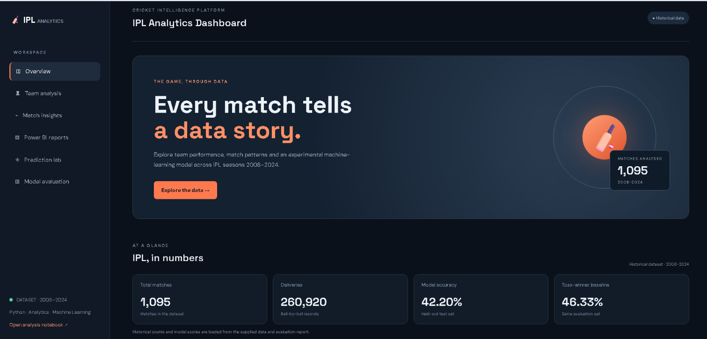
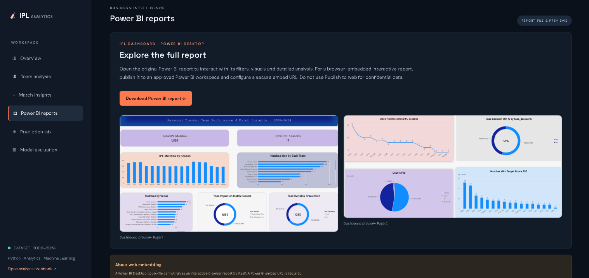
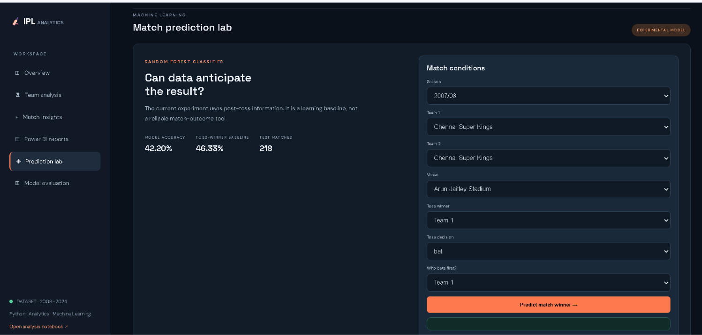
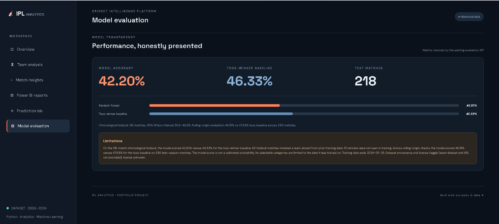
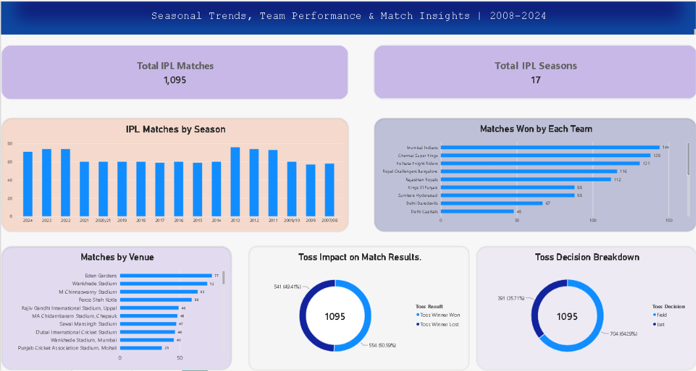
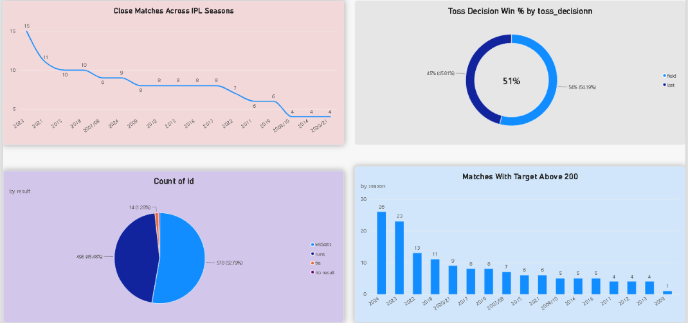

# IPL Analytics

A multi-page IPL analytics website, historical analysis notebook, Power BI report and experimental Random Forest prediction API.

## Run locally (Windows)

From this project folder, open PowerShell or the VS Code terminal:

```powershell
py -3.12 -m venv .venv
.venv\Scripts\activate
python -m pip install --upgrade pip
pip install -r requirements.txt
python backend\analytics.py
python backend\app.py
```

Place `matches.csv` and `deliveries.csv` in `Dataset\` or in your Windows `Downloads` folder before running the evaluation command. The app checks these locations automatically. Alternatively, set `IPL_MATCHES_CSV` and `IPL_DELIVERIES_CSV` to the absolute paths of the files. The evaluation command creates a model trained on all labeled matches and writes `models\model_evaluation.json`. Its chronological holdout and rolling-origin metrics are calculated before the full-data model is trained.

Open http://127.0.0.1:5000. Navigation opens independent views; scrolling within a view does not reset the selected page.

Run the focused checks from the project root:

```powershell
python -m unittest backend.test_app
```

## Power BI

Open `PowerBI/IPL_DASHBOARD_REPORT.pbix` in Power BI Desktop. The website's Power BI Reports page includes previews and a download link. To embed an interactive report in the website, configure a Power BI embed URL in a future deployment. A `.pbix` file cannot be embedded directly as a live web report.


## Website Screenshots

### 1. Overview


### 2. Team Analysis


### 3. Match Insights


### 4. Power BI Reports


### 5. Prediction Lab


### 6. Model Evaluation


## Power BI Dashboard — Actual Report Pages

### Report Page 1


### Report Page 2



## Project contents

- `Analysis/` — IPL analysis handbook notebook
- `PowerBI/` — original Power BI report
- `Dashboard_Screenshots/` — report previews
- `Dataset/` — dataset setup notes (raw CSVs are not bundled)
- `frontend/` — responsive multi-page website interface
- `backend/` — Flask API and prediction endpoint
- `models/` — trained Random Forest pipeline

## Model transparency

Run `python backend\analytics.py` to regenerate the evaluation report from the supplied data. The current report uses an 80/20 chronological split over 1,090 matches with recorded winners: 872 training matches and 218 test matches from 2022–2024. The Random Forest correctly classified 92/218 (42.20%), compared with 101/218 (46.33%) for the toss-winner baseline. Five additional rolling-origin season checks aggregate 156/338 correct (46.15%), below their 47.63% toss baseline. The report includes confidence intervals, macro/weighted F1, unseen-team counts, data hashes, and per-season results.

The supplied evaluation is evidence that this experiment does **not** outperform its toss baseline. Keep it labeled experimental; do not present its per-match model score as a calibrated probability. Its selectable seasons, teams, venues, and toss decisions come from the trained artifact. The user identified the CSVs as coming from Kaggle; the exact dataset and URL are not provided, and the license is unknown. Verify the dataset's terms before redistribution.

The results can differ from the notebook's previously reported 43.12%; the new score is regenerated from the uploaded CSVs with the documented chronological split and canonical team names. The report records its protocol and input file hashes so future runs can be compared reproducibly.

## Author

[GitHub](https://github.com/Rakeshmadival) · [LinkedIn](https://linkedin.com/in/rakesh-madival31)
